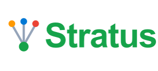

<div align="center">



**A multi-cloud gateway to your virtual machines.** Authenticate once, see all your VMs across AWS, Azure and GCP according to your permissions, and connect in a single click.


[](https://goreportcard.com/report/github.com/muhamm-ad/stratus)
[](https://github.com/muhamm-ad/stratus/releases/latest)

</div>

> [!WARNING]
> The documentation may be outdated since the project is still in development.

---

## Overview

Modern environments are spread across several clouds. Connecting to a virtual machine today means knowing where it lives, finding the right credentials, opening the right console and managing your keys. Stratus removes that friction: a single sign-on, an inventory aggregated and filtered by your permissions, and a one-click connection through each provider's native method.

Stratus is a desktop application (Linux, macOS, Windows) shipped as a single binary, paired with a command-line interface for automation.

## Features

- Single sign-on (SSO) to AWS, Azure and GCP through the system browser (RFC 8252).
- Aggregated VM inventory, filtered by each platform's RBAC: you only see what you are allowed to see.
- One-click connection, no SSH key to manage: SSM Session Manager (AWS), Bastion or SSH (Azure), IAP (GCP).
- Filtering and search by provider, region, state and tag.

## Architecture

Stratus separates a UI-independent core, connectors (one per provider, each implementing a common `CloudProvider` interface), and two frontends: the Wails graphical interface and the terminal UI. VM discovery goes through the official cloud SDKs; connection is delegated to the providers. The full detail is in [`docs/architecture.md`](docs/architecture.md).

## Install

```bash
go install github.com/muhamm-ad/stratus/cmd/tui@<version>
go install github.com/muhamm-ad/stratus/cmd/gui@<version>
```

Replace `<version>` with a tagged release (for example `v1.0.0`) or `latest`. Requires [Go](https://go.dev/dl/).

## Contributing

We welcome contributions! Please read the [contribution guidelines](CONTRIBUTING.md) before submitting a pull request.

## Contact

If you have any questions or feedback, please open an issue.
